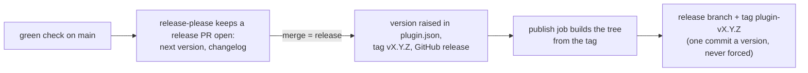

# Contributing

Node 26 or newer runs everything, TypeScript tools included (types stripped). No Python, no shell script, no other toolchain.

## Set up

Two things come first: [mise](https://mise.jdx.dev), which installs what `mise.toml` pins, and `claude` (Claude Code) on the PATH, at the `CLAUDE_CODE_VERSION` that `check.yml` pins, since `npm run setup` and `npm run check` use it.

```bash
mise install                 # Node and the scanners `npm run scan` runs, at the versions mise.toml pins
npm ci
npm run setup                # git hooks, and the engine's declarations into .claude-plugin/types/
claude --plugin-dir .        # run the mod from this clone
npm run check && npm test    # everything a commit and a push must pass
```

## Scripts

| Script | Checks |
| --- | --- |
| `npm run setup` | Writes the git hooks (`simple-git-hooks`) and unpacks the engine's declarations from the `claude` on your PATH (`tools/engine_types.ts`: no sign-in, no model call, git-ignored). |
| `npm run files` | JSON and YAML parse; no conflict markers, private keys or files over 500 kB; no `oxlint-` or `eslint-` directive comment in any script (checked here because oxlint obeys a blanket disable even over the rule refusing it); one final newline, no trailing whitespace. |
| `npm run format` | Writes the formatting: [Biome](https://biomejs.dev) as formatter only (`biome.jsonc`), oxlint stays the linter. The tools that generate `hooks/gitlab.generated.ts`, the schema snapshot and `tests/docs.generated.ts` format their output through it. |
| `npm run format:check` | Every TS, TSX, JS, CJS and JSON file is formatted as `npm run format` writes it (`package-lock.json` apart: npm writes it). |
| `npm run knip` | No unused file, export, type or dependency; each entry point in `knip.jsonc` has its reason. |
| `npm run lint` | [oxlint](https://oxc.rs) over `hooks/`, `tests/`, `specs/`, `tools/`, `chatgpt/` (`oxlint.config.ts`): no `x as T`, `any`, `!` or module state; `hooks/` files within 400 lines; the core imports core files only, without the `.ts` extension, and a `hooks/` module that imports nothing of the engine, no package and no module that does is in the core; type-aware rules through `oxlint-tsgolint`, which is TypeScript 7 inside. The local rules are `tools/lint_rules.ts`, tested in `tools/lint_rules.spec.ts`. |
| `npm run types` | TypeScript 7 over `tsconfig.core.json`, `tsconfig.json`, `tools/store-probe/tsconfig.json`, `tools/tsconfig.json` and `chatgpt/tsconfig.json`. |
| `npm run schema -- types --check` | `hooks/gitlab.generated.ts` is what graphql-codegen makes of the snapshot and the documents. |
| `npm run release-tree -- check` | The tree built from `release-tree/files` loads only what it holds, and holds the ChatGPT plugin, built at the tree's version with an `mcp.json` ChatGPT reads. |
| `npm run docs -- check` | README's settings table is `userConfig`; README's and DESIGN's tables are `tests/docs.generated.ts` (`docs -- write` remakes it, `tests/docs.test.ts` holds it to the code); the scripts table here is `package.json`'s scripts. |
| `npm run validate` | `claude plugin validate --strict` on the plugin and the store probe. |
| `npm run scan` | gitleaks, actionlint, zizmor: each only if installed, and a skipped one is named. |
| `npm run check:fast` | `files`, `format:check`, `knip`, `lint`, `types`, `schema -- types --check`, `release-tree -- check`, `docs -- check`, `validate`. |
| `npm run check` | `check:fast`, then `scan`. |
| `npm test` | Vitest on the core and the dev tools' own specs (plain Node), `claude plugin test .` (the engine), then the scenes, then the ChatGPT plugin: a merge pressed through its server on the made-up GitLab (`chatgpt/move-check.ts`), its package built, and the packaged server serving the panel by its hash (`chatgpt/probe.ts`). Vitest runs its specs in a Node that refuses to write, start a process or thread, connect, or read outside the repository (`vitest.config.ts`), each within two seconds: those specs work on plain data. |
| `npm run panel` | The ChatGPT plugin's panel in Chromium behind the MCP Apps host bridge, as ChatGPT opens it: every row drawn without an error, then a merge pressed twice on the made-up GitLab (`chatgpt/panel-test.ts`; `--live` reads your GitLab and presses nothing). |
| `npm run schema -- <check\|snapshot\|types>` | `check`: every query against gitlab.com's live schema, and what each costs; `snapshot`: refresh the snapshot; `types`: regenerate the types. |
| `npm run screens -- <render\|setup\|scenes>` | `render` photographs the pane, and the ChatGPT plugin's panel, in Chromium for `docs/screens`; `setup` fetches Chromium; `scenes` runs the scenes. |
| `npm run rig -- flow` | Drives the pane through a headless engine. |
| `npm run preview` | Serves the pane this checkout draws, live from your GitLab, on 127.0.0.1 (`--help`; [what it cannot show](#checking-the-pane-in-the-desktop-app)). |
| `npm run shot -- <capture\|press\|tour\|windows>` | Photographs and presses the pane in the running desktop app; Mac only ([when](#checking-the-pane-in-the-desktop-app)). |
| `npm run commit-msg` | commitlint on a message file (the commit-msg hook). |
| `npm run pr-title` | commitlint on stdin (CI, for a pull request's title). |

## Where each check runs

| Check | On edit | Commit | Push | CI | Weekly canary |
| --- | :-: | :-: | :-: | :-: | :-: |
| Core `tsc`, oxlint and `biome format` on the file edited (`tools/check_core.ts`) | x | | | | |
| `check:fast` | | x | | x | |
| `scan` (gitleaks on the staged change only) | | x | | x | |
| Commit message and pull request title (commitlint) | | x | | x | |
| Author and committer are noreply addresses | | | | x | |
| `npm test` | | | x | x | x, `claude plugin test .` on the newest Claude Code |
| `claude plugin validate --strict` and `claude plugin test .` on the stable channel's Claude Code | | | | x | |
| Release tree builds and validates | | | | x | x, and installs |
| The tree's ChatGPT plugin installs in Codex and starts its server (`chatgpt/codex-check.ts`) | | | | x | |
| `npm run panel` | | | | x, when the drawing changes | |
| `screens -- render --verify --check` | | | | x, when the drawing changes | |
| `schema -- check` against gitlab.com | | | | x, when queries change | x |
| Plugin installs from GitHub; release branch holds the latest tag | | | | | x |
| gitleaks over the whole history | | | | | x |

Workflows: `check.yml` (checks, scanners, release), `screens.yml`, `canary.yml`. One Claude Code version is pinned in `check.yml` (twice), `screens.yml` and `tools/pane_screens.ts`; Renovate raises all four in one pull request (`renovate.json`), which fails `screens.yml` until `npm run screens -- render` is committed if the new version draws the pane differently. `check.yml` also validates and tests the plugin on `CLAUDE_CODE_STABLE`, the version npm's `stable` tag names, which is what the stable release channel installs and usually older than the pin; Renovate keeps it on that tag. Renovate also keeps the actions and the tooling current, once a month and only with releases out for 14 days. The canary failing on the newest Claude Code or on a changed schema opens an issue; the next green run closes it.

## Duplicate-code sweep

Open **Actions → Duplicate code → Run workflow** for a technical-debt sweep. The run summary folds PMD-CPD's TypeScript copy-paste matches, jscpd's TypeScript and TSX matches, and Reprise's structural matches into one report. Leave `base` empty for a full scan. Set it to a Git ref to have Reprise compare against the merge base of that ref and the selected checkout. The report is advisory. Workflow runs on pull requests are limited to changes to the report tooling itself.

An agent can trace the reported paths, collapse overlapping results and verify whether the copies implement a rule that should change together. Fix a verified issue in the change that exposed it when the fix belongs there. For an occasional sweep, pick the independent fixes that eliminate work or prevent a plausible repeat bug. A repeated test setup, query shape or comment-only drift alert can be intentional or harmless.

For a local run with the three binaries on PATH, use `node --import ./tools/resolve_ts.ts tools/duplicates.ts`, optionally with `--base origin/main`. The workflow pins the detector versions.

## GitLab's types

Each question the pane asks GitLab is one `hooks/ask-*.ts` module: its `/* GraphQL */` documents, the request, the cost, and how its answer reads. A new question is a new module, added to `hooks/gitlab-operations.ts` (and `tsconfig.core.json`, `release-tree/files`); a document names the fragments it spreads and `documentOf` appends them, so no list of fragments is kept by hand. Edit a document, run `npm run schema -- types`, commit `hooks/gitlab.generated.ts`: a field the schema lets be null is `| null` there, and the code must handle it.
`tools/gitlab_schema.snapshot.json` is the slice of gitlab.com's schema the documents use; `npm run schema -- snapshot` then `types` takes the schema as it is now.
A document's cost is stated in `COMPLEXITY`, which `schema -- check` verifies. A host that answers `undefinedField` is sent the variant without that field.

## Commits

- Conventional messages (`feat:`, `fix(jira):`, `docs:` ...), because releases are worked out from them. Merge a pull request with a squash: its title becomes the commit on main.
- Author and committer must be GitHub noreply addresses (from https://github.com/settings/emails; turn on "Keep my email addresses private"), or `noreply@anthropic.com` as committer for a commit Claude signed.

## Releasing



- While the version is 0.x, `feat:` and `fix:` both raise the patch number (0.4.0 to 0.4.1); `!` or a `BREAKING CHANGE:` footer raises the minor (`bump-patch-for-minor-pre-major` and `bump-minor-pre-major` in `release-please-config.json`). Other kinds wait for one of those.
- No check starts on the release PR by itself, as GitHub starts no workflow for a PR its own token opened, yet main requires `check` before any merge. To release, close the PR and reopen it as yourself: that starts its checks, and it merges once they pass. A run started by hand (`gh workflow run check.yml --ref <its branch>`) passes on the same commit but does not count, because GitHub ties it to no pull request.
- Users get the files in `release-tree/files` (`plugin.json`, `hooks/` without the generated types, `types/index.d.ts`, `LICENSE`, `README.md`), and the ChatGPT plugin's built package in `chatgpt/`, and nothing else. A file the mod loads at run time goes in that list; `release-tree -- check` fails otherwise.
- A team pins `"ref": "plugin-vX.Y.Z"` in its marketplace source (the tree has its own `release-tree/marketplace.json`).
- The same tree holds the ChatGPT plugin in `chatgpt/`, built by `chatgpt/build.ts` at the release's version, and a Codex marketplace that lists it (`release-tree/codex-marketplace.json`, at `.agents/plugins/marketplace.json`, which ChatGPT's Codex reads before the Claude one). `codex plugin marketplace add alxleo/gitlab-pane --ref release` follows releases; `--ref plugin-vX.Y.Z` pins one. One version names both plugins.
- The default install reads `.claude-plugin/marketplace.json` on main (`"source": "./"`). Once the first `plugin-v*` tag exists, switch it to `{ "source": "github", "repo": "alxleo/gitlab-pane", "ref": "release" }` in its own commit, and change the README's "That follows main" to "That follows releases".

## Screenshots

`docs/screens` comes from `npm run screens -- render` (the mod's own drawing under the pinned Claude Code, photographed in Chromium; run `screens -- setup` first, `setup --with-deps` on Linux). Run it after changing the drawing and commit the pictures; `screens.yml` fails on a stale one.

The same commit draws the same letters on a Mac and on Linux, but not the same bytes, and `screens.yml` compares bytes on Linux. On a Mac, render the pictures you commit in Playwright's Ubuntu image, which draws what CI draws (CI's steps pass there):

```bash
docker run --rm --platform linux/amd64 -v "$PWD":/src:ro -v "$PWD/docs/screens":/out mcr.microsoft.com/playwright:v1.64.1-noble bash -c 'mkdir /work && cd /src && tar --exclude=./node_modules --exclude=./.git -cf - . | tar -xf - -C /work && cd /work && npm install --global @anthropic-ai/claude-code@2.1.318 && npm ci --ignore-scripts && npm run screens -- render --out /out'
```

The image's version is Playwright's in `package-lock.json`, and the Claude Code is the one CI pins.

Every scene is photographed in the desktop app's light theme, `<scene>.png`, and its dark theme, `<scene>-dark.png`; the README shows the one that matches the reader's.

The ChatGPT plugin's panel is photographed beside the scenes, as `chatgpt-panel.png` and `chatgpt-panel-dark.png` (`tools/chatgpt_screens.ts`): its own server on the made-up GitLab, the clock held at the scenes' moment, the panel opened behind the MCP Apps host bridge, and the bundled fonts handed to it as a host hands its own. `--scene chatgpt-panel` takes it alone, and needs no Claude Code. Both kinds go through `tools/photograph.ts`, which holds the browser, the themes and the font checks. Pull-request delta pictures are of the pane alone; for the panel, show its picture before and after.

A pull request's pictures come from `npm run screens -- render --out <dir> --delta-against origin/main`. For each scene, in each theme (`<scene>` and `<scene>-dark`), it writes three pictures:
- `<scene>.png`, as the branch draws it;
- `<scene>-before.png`, as main draws it;
- `<scene>-delta.png`, the branch's picture with what changed at full strength and outlined, and everything else faded.

It compares elements, not pixels, so a row that only moved down stays faded. The look of the desktop's elements in each theme is `tools/screens/pane.css`; what each colour and mark means is [DESIGN.md](DESIGN.md).

## Checking the pane in the desktop app

The rig, the preview and the shot answer different questions. `npm run rig -- flow` stands in for the desktop: it asks a headless engine for drawings, presses and scrolls as the desktop would, and prints what came back. It runs anywhere, CI included, so reach for it first, for anything about what the mod draws or how it answers.

`npm run preview` is the same engine drawn in a browser, so a branch can be looked at and used without loading it in the desktop app, whatever copy is installed there. In the Claude app, start `pane-preview` from `.claude/launch.json` in the browser pane; elsewhere, open http://127.0.0.1:4780. The page redraws whenever the engine does, and clicks, picks in a picker, typing, Enter and scrolling go back to the engine by element key. They reach GitLab as they would from the desktop app, so a merge pressed here is a merge. A second checkout needs `--port`; the page names the checkout and branch it shows.

The preview draws with the screenshots' stylesheet, not the app's own paint, so it cannot show what only the desktop app does:
- it draws a Button's `label` and not its children, so a symbol in a Button's children shows here and not there;
- an Input keeps the person's typing across redraws in its own way, which the preview only approximates;
- it draws a blank pane past 100,000 characters (`DRAWING_BUDGET`), which the preview draws in full;
- hover cards, the app's fonts and its window's width.

`npm run shot` stays for those.

`npm run shot` looks at the real desktop app on a Mac. Reach for it when the question is what the app itself does with the drawing: whether a click lands, where a hover card pushes the rows, how a narrow window wraps a card, or a bug the rig cannot reproduce. It reads the pane off the screen with macOS text recognition, clicks and scrolls through Hammerspoon, and writes the pane alone as a PNG. The pictures show real MR titles and names, so write them outside the checkout:

```bash
npm run shot -- capture -o "$TMPDIR/pane.png"
```

```bash
npm run shot -- press "read whole" -o "$TMPDIR/after.png"
```

`--help` lists the rest (`windows`, `tour`, `capture --to bottom`). It needs Hammerspoon with its `hs` command (`require("hs.ipc")` in its config, then `hs.ipc.cliInstall()`), Accessibility for Hammerspoon, and Screen Recording for the terminal that runs it.

The app takes a click or a scroll only while its window is in front, so the shot refuses to click, scroll or move the pointer otherwise, and never takes focus on its own; a capture of a window behind others says it was read without the pointer parked, so a hover card may show in it. Run it when the person at the Mac says the pane is showing, never on a timer or in CI. `--raise` brings the window forward only when nobody has typed or moved the pointer for a few seconds, and gives focus back after. Every session's pane sits in the same place, so pass `--session` with the name in the window's header when it matters which session's pane you photograph.

<!-- Temporary fixture for the shared Workflow Check pilot. -->
