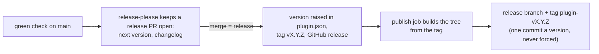

# Contributing

Node 26 or newer runs everything, TypeScript tools included (types stripped). No Python, no shell script, no other toolchain.

## Set up

```bash
npm ci
npm run setup                # git hooks, and the engine's declarations into .claude-plugin/types/
claude --plugin-dir .        # run the mod from this clone
npm run check && npm test    # everything a commit and a push must pass
```

## Scripts

| Script | Checks |
| --- | --- |
| `npm run setup` | Writes the git hooks (`simple-git-hooks`) and unpacks the engine's declarations from the `claude` on your PATH (`tools/engine_types.ts`: no sign-in, no network, git-ignored). |
| `npm run files` | JSON and YAML parse; no conflict markers, private keys or files over 500 kB; no `oxlint-` or `eslint-` directive comment in any script (checked here because oxlint obeys a blanket disable even over the rule refusing it); one final newline, no trailing whitespace. |
| `npm run format` | Writes the formatting: [Biome](https://biomejs.dev) as formatter only (`biome.jsonc`), oxlint stays the linter. The tools that generate `hooks/gitlab.generated.ts`, the schema snapshot and `tests/docs.generated.ts` format their output through it. |
| `npm run format:check` | Every TS, TSX, JS, CJS and JSON file is formatted as `npm run format` writes it (`package-lock.json` apart: npm writes it). |
| `npm run knip` | No unused file, export, type or dependency; each entry point in `knip.jsonc` has its reason. |
| `npm run lint` | [oxlint](https://oxc.rs) over `hooks/`, `tests/`, `tools/` (`oxlint.config.ts`): no `x as T`, `any`, `!` or module state; `hooks/` files within 400 lines; the core imports core files only, by `.ts` path; type-aware rules through `oxlint-tsgolint`, which is TypeScript 7 inside. The local rules are `tools/lint_rules.ts`, tested in `tools/lint_rules.spec.ts`. |
| `npm run types` | TypeScript 7 over `tsconfig.core.json`, `tsconfig.json`, `tools/store-probe/tsconfig.json` and `tools/tsconfig.json`. |
| `npm run schema -- types --check` | `hooks/gitlab.generated.ts` is what graphql-codegen makes of the snapshot and the documents. |
| `npm run release-tree -- check` | The tree built from `release/files` loads only what it holds. |
| `npm run docs -- check` | README's settings table is `userConfig`; README's and DESIGN's tables are `tests/docs.generated.ts` (`docs -- write` remakes it, `tests/docs.test.ts` holds it to the code); the scripts table here is `package.json`'s scripts. |
| `npm run validate` | `claude plugin validate --strict` on the plugin and the store probe. |
| `npm run scan` | gitleaks, actionlint, zizmor: each only if installed, and a skipped one is named. |
| `npm run check:fast` | `files`, `format:check`, `knip`, `lint`, `types`, `schema -- types --check`, `release-tree -- check`, `docs -- check`, `validate`. |
| `npm run check` | `check:fast`, then `scan`. |
| `npm test` | Vitest on the core and the dev tools' own specs (plain Node), `claude plugin test .` (the engine), then the scenes. |
| `npm run schema -- <check\|snapshot\|types>` | `check`: every query against gitlab.com's live schema, and what each costs; `snapshot`: refresh the snapshot; `types`: regenerate the types. |
| `npm run screens -- <render\|setup\|scenes>` | `render` photographs the pane in Chromium for `docs/screens`; `setup` fetches Chromium; `scenes` runs the scenes. |
| `npm run rig -- flow` | Drives the pane through a headless engine. |
| `npm run commit-msg` | commitlint on a message file (the commit-msg hook). |
| `npm run pr-title` | commitlint on stdin (CI, for a pull request's title). |

## Where each check runs

| Check | On edit | Commit | Push | CI | Weekly canary |
| --- | :-: | :-: | :-: | :-: | :-: |
| Core `tsc`, oxlint and `biome format` on the file edited (`tools/check_core.ts`) | x | | | | |
| `check:fast` | | x | | x | |
| `scan` (gitleaks on the staged change only) | | x | | x | |
| Commit message and pull request title (commitlint) | | x | | x | |
| Author and committer are noreply addresses | | | | x | |
| `npm test` | | | x | x | x, `claude plugin test .` on the newest Claude Code |
| Release tree builds and validates | | | | x | x, and installs |
| `screens -- render --verify --check` | | | | x, when the drawing changes | |
| `schema -- check` against gitlab.com | | | | x, when queries change | x |
| Plugin installs from GitHub; release branch holds the latest tag | | | | | x |
| gitleaks over the whole history | | | | | x |

Workflows: `check.yml` (checks, scanners, release), `screens.yml`, `canary.yml`. One Claude Code version is pinned in `check.yml` (twice), `screens.yml` and `tools/pane_screens.ts`; Renovate raises all four in one pull request (`renovate.json`), which fails `screens.yml` until `npm run screens -- render` is committed if the new version draws the pane differently. Renovate also keeps the actions and the tooling current, once a month and only with releases out for 14 days. The canary failing on the newest Claude Code or on a changed schema opens an issue; the next green run closes it.

## GitLab's types

Edit the `/* GraphQL */` documents in `hooks/gitlab-documents.ts`, run `npm run schema -- types`, commit `hooks/gitlab.generated.ts`: a field the schema lets be null is `| null` there, and the code must handle it.
`tools/gitlab_schema.snapshot.json` is the slice of gitlab.com's schema the documents use; `npm run schema -- snapshot` then `types` takes the schema as it is now.
A document's cost is stated in `COMPLEXITY`, which `schema -- check` verifies. A host that answers `undefinedField` is sent the variant without that field.

## Commits

- Conventional messages (`feat:`, `fix(jira):`, `docs:` ...), because releases are worked out from them. Merge a pull request with a squash: its title becomes the commit on main.
- Author and committer must be GitHub noreply addresses (from https://github.com/settings/emails; turn on "Keep my email addresses private"), or `noreply@anthropic.com` as committer for a commit Claude signed.

## Releasing



- `feat:` raises the minor number, `fix:` the patch; `!` or a `BREAKING CHANGE:` footer raises the minor while the version is 0.x. Other kinds wait for one of those.
- No check starts on the release PR by itself, as GitHub starts no workflow for a PR its own token opened, yet main requires `check` before any merge. To release, close the PR and reopen it as yourself: that starts its checks, and it merges once they pass. A run started by hand (`gh workflow run check.yml --ref <its branch>`) passes on the same commit but does not count, because GitHub ties it to no pull request.
- Users get the files in `release/files` and nothing else (`plugin.json`, `hooks/` without the generated types, `types/index.d.ts`, `LICENSE`, `README.md`). A file the plugin loads at run time goes in that list; `release-tree -- check` fails otherwise.
- A team pins `"ref": "plugin-vX.Y.Z"` in its marketplace source (the tree has its own `release/marketplace.json`).
- The default install reads `.claude-plugin/marketplace.json` on main (`"source": "./"`). Once the first `plugin-v*` tag exists, switch it to `{ "source": "github", "repo": "alxleo/gitlab-pane", "ref": "release" }` in its own commit, and change the README's "That follows main" to "That follows releases".

## Screenshots

`docs/screens` comes from `npm run screens -- render` (the mod's own drawing under the pinned Claude Code, photographed in Chromium; run `screens -- setup` first, `setup --with-deps` on Linux). Run it after changing the drawing and commit the pictures; `screens.yml` fails on a stale one. The look of the desktop's elements is `tools/screens/pane.css`; what each colour and mark means is [DESIGN.md](DESIGN.md).
