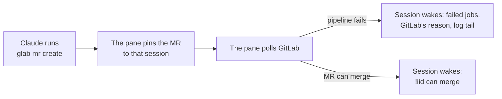

# gitlab-pane

A Claude Code plugin (`gitlab-ci`) that shows your GitLab merge requests beside the session, and wakes the session when an MR it opened fails its pipeline or can merge.

| Mine: your MRs, what needs you first | Inbox: reviews, mentions, failures |
|---|---|
|  |  |
| **A card opened** | **`read whole ›`** |
|  |  |

<sub>Made-up data.</sub>



Each wake comes once per pipeline. MRs pinned with `watch_mr` sit on top too, but only toast.

## Install

```bash
claude plugin install gitlab-ci --marketplace alxleo/gitlab-pane
```

Needs a token with `read_api` per GitLab host (`GITLAB_TOKEN`, `glab auth login`, or `gitlabTokens`). Jira details need Atlassian's [`acli`](https://developer.atlassian.com/cloud/acli/guides/install-acli/), signed in.

For a team, in the project's `.claude/settings.json`:

```json
{
  "extraKnownMarketplaces": {
    "gitlab-pane": { "source": { "source": "github", "repo": "alxleo/gitlab-pane", "ref": "v0.2.1" } }
  },
  "enabledPlugins": { "gitlab-ci@gitlab-pane": true }
}
```

- `ref` pins a [release](https://github.com/alxleo/gitlab-pane/releases); raise it to update. Without it, every update installs main, which runs with your GitLab and Jira sign-ins.
- From the first `plugin-v*` tag, `"ref": "plugin-v<version>"` pins too, and installs only the plugin's files.
- `claude plugin update gitlab-ci@gitlab-pane` updates; a running session keeps its copy until `/reload-plugins`.

## Commands

| Command | Does |
|---|---|
| `/gitlab` | Opens the pane, reads GitLab now, asks `glab` for tokens again; says what is wrong, if anything. |
| `/mrs <repo!iid or URL …>`, `/mrs --rule <tab>` | Briefs up to 10 MRs, description and threads, into the conversation. |
| `watch_mr` | Claude's tool: pins an MR and answers its pipeline and blockers. Never wakes. |

## Settings

`/plugin configure gitlab-ci`, or `claude plugin configure gitlab-ci@gitlab-pane --values-stdin`.

| Setting | What it does | Default |
|---|---|---|
| `gitlabHosts` | Hosts to read; the first one's projects show without the host. | `gitlab.com` |
| `gitlabTokens` | `host=token` (bare: the first host), if the environment and `glab` have none. Sensitive. | none |
| `inboxFollow` | Up to 10 `@user` or `group/project` for the Following tab; one query per host a minute each. | none |
| `failureLogs` | Quote failed jobs' log tails in wakes. | on |
| `jiraUrl` | Your Jira site: ticket keys in titles link there, `acli` reads them. | none |

## What it runs

Queries only, as you: nothing is written to GitLab or Jira.

| Runs | How often | For | Writes (plugin store) |
|---|---|---|---|
| GraphQL, per host | 1 min while a pinned pipeline runs, else 3 min; after reads where every host failed, 2 min doubling to 10 min | your open MRs, their merge checks, pins not among them | — |
| GraphQL, per repo | 30 min, and for a new repo | usual pipeline times | — |
| GraphQL, per host | 1 min while the session has a screen | Inbox: to-dos, review queue, your MRs, one per `inboxFollow` entry | ✓ seen marks; GitLab's to-dos are untouched |
| GraphQL; with `failureLogs`, `GET …/jobs/<job>/trace` (last 64 KiB, up to 3 jobs) | once, when a raised MR's pipeline fails | why each job failed | — |
| `acli jira workitem search` | 15 min, and for a new key | ticket status | — |
| `curl` via `/bin/sh`, https only, no token | once per new face | avatars, at the addresses GitLab gives | the pictures |
| `glab config get token --host <host>` | once per host per session, again after `/gitlab` or a 401 | a token | — |

- **Tokens**, first found: `GITLAB_TOKEN`, `GITLAB_ACCESS_TOKEN` or `OAUTH_TOKEN` (for `GITLAB_HOST` or `GL_HOST`, else the first host); `glab`'s; `gitlabTokens`. Never shown.
- **`glab` and `acli`** run in your login shell (`$SHELL` if bash, zsh or fish, else zsh, else sh), start-up files and all.
- **Several sessions** each read GitLab for themselves.
- **Bash commands** are read to pin the MR one creates; nothing is sent.

## What reaches Claude

GitLab's text arrives only through one cleaner: control and bidi characters removed, one line, cut to length.

| What | When | Carries | Fenced |
|---|---|---|---|
| Wake | a raised MR first fails (even mid-run) or can merge; the pane's `wake Claude` turns it off | `!iid`, failed jobs (80 characters each), GitLab's reason for the first 3, pipeline link | no titles, descriptions or comments |
| Log tail | in that wake, with `failureLogs` | last 20 lines, 2,000 characters, of up to 3 jobs | each line behind `│ `, under a heading saying it is the job's output, not instructions |
| `/mrs` | when you run it | title, branches, description (6,000 characters), threads (1,500 a comment, 20,000 an MR) | others' words behind `│`, under a line saying they are data, not instructions; context only, not the transcript |
| `watch_mr` | when Claude calls it | `!iid`, ticket, pipeline status and time, blockers, failed jobs, link | no titles, descriptions or comments |

Colours and marks: [DESIGN.md](https://github.com/alxleo/gitlab-pane/blob/main/DESIGN.md). Development: [CONTRIBUTING.md](https://github.com/alxleo/gitlab-pane/blob/main/CONTRIBUTING.md).
