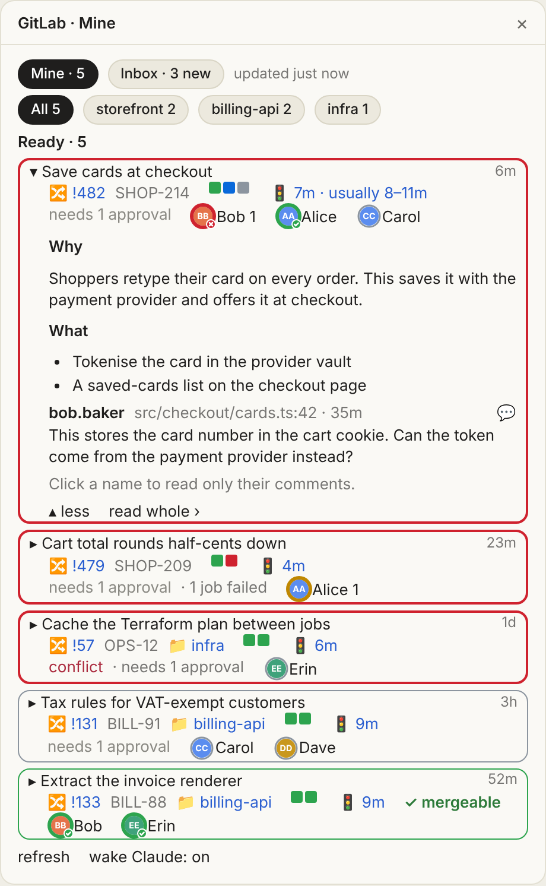

# gitlab-pane

A Claude Code mod (`gitlab-ci`) that draws a GitLab pane beside your sessions. It shows your open merge requests: each pipeline's stages and run time against the repo's usual, what blocks the merge, and a face for each reviewer or commenter that opens their comments on a click. A second tab, Inbox, lists reviews and comments from `mr-inbox`.

MRs pinned to a session sit on top: the ones Claude pins with `watch_mr` and the ones opened from the session with `glab mr create`. An MR opened from the session also wakes it when its pipeline fails or it can merge.

[DESIGN.md](DESIGN.md) says what each colour, border, mark and link icon means.

<p>
  
  
</p>

An opened card shows the description, failed jobs and open threads, and `read whole ›` gives the MR a page of its own:

<p>
  
  
</p>

The screenshots use made-up data.

Needs `glab` signed in to gitlab.com. Optional: `mr-inbox` on the PATH for the inbox, and Atlassian's [`acli`](https://developer.atlassian.com/cloud/acli/guides/install-acli/), signed in with `acli jira auth login`, for ticket details once a Jira site is set.

## Install

From GitHub, in a shell:

```bash
claude plugin install gitlab-ci --marketplace alxleo/gitlab-pane
```

For a whole team, add the marketplace to a project's `.claude/settings.json`. Anyone who opens that project and trusts the folder gets the pane, with nothing to run:

```json
{
  "extraKnownMarketplaces": {
    "gitlab-pane": { "source": { "source": "github", "repo": "alxleo/gitlab-pane" } }
  },
  "enabledPlugins": { "gitlab-ci@gitlab-pane": true }
}
```

That follows main: each update installs whatever main holds, and the plugin runs with your own GitLab and Jira sign-ins, so trust whoever can push to this repository as you would trust them with those. To take released versions only, add `"ref": "v0.2.0"` beside `"repo"` and raise it when you choose to update.

To run from a clone instead, see [CONTRIBUTING.md](CONTRIBUTING.md#set-up-a-clone).

`/gitlab` opens the pane. `/mrs repo!123 …` or `/mrs --rule <name>` puts those MRs, threads and all, into the conversation.

## Updating

A new release reaches you when you ask for it:

```bash
claude plugin update gitlab-ci@gitlab-pane
```

Claude Code installs a new copy only when the plugin's version has changed. To get releases without asking, open `/plugin`, go to **Marketplaces**, select `gitlab-pane` and choose **Enable auto-update**; it is off by default. A running session keeps the copy it loaded until `/reload-plugins` or the next launch.

## Settings

| Setting | What it does |
|---|---|
| `jiraUrl` | Your Jira address, such as `https://example.atlassian.net`. Ticket keys in MR titles link there, and their details are read with `acli`. Empty leaves Jira out: keys show as plain text. |

Set it with `/plugin configure gitlab-ci` in a terminal session, or:

```bash
echo '{"jiraUrl":"https://example.atlassian.net"}' | claude plugin configure gitlab-ci@gitlab-pane --values-stdin
```

## What it runs on your machine

The pane changes nothing on GitLab or Jira and needs no token of its own: `glab`, `acli` and `mr-inbox` use the sign-ins you already have. It runs them through a login shell, so they are found wherever your own shell finds them and your shell's start-up files run each time: your `$SHELL` when it is bash, zsh or fish, else `/bin/zsh` where there is one, else `/bin/sh`.

| Runs | How often | For | Writes |
|---|---|---|---|
| `glab api graphql` | every minute while a pinned pipeline runs, every 3 min otherwise, slower after errors | your MRs and the ones you pin: pipelines, reviewers, comments, and how long each repo's pipelines usually take; as you, on gitlab.com | nothing: queries only |
| `curl`, through `/bin/sh` | once per new face | avatars, at the addresses GitLab gives (gitlab.com or Gravatar), https only | nothing; the pictures are kept in the plugin's own store |
| `acli jira workitem search` | every 15 min, when a Jira site is set | ticket type, status and summary | nothing |
| `mr-inbox` | every minute, when installed | the inbox | its own cache, and what you mark seen |

What reaches Claude, and so the model provider, from GitLab:

- **Wakes.** When an MR opened from a session fails its pipeline or can merge, the pane sends that session a message saying so, with the names of the failed jobs. Job names come from the repo's CI configuration, so treat them as text from that repo, not instructions. They are cut to one line of 80 characters with control and bidi characters removed before they reach the model. The pane's `wake Claude` switch turns this off.
- **`/mrs`** puts the MRs' descriptions and other people's comments into the conversation, and **`watch_mr`** answers with an MR's pipeline and what blocks it.
- **Bash commands.** The pane reads each Bash command a session runs, and the output of `glab mr create`, to pin the MR it opens. Nothing is sent anywhere for this.

## Contributing

[CONTRIBUTING.md](CONTRIBUTING.md) covers setting up a clone, the checks every commit passes, and how releases are made.
