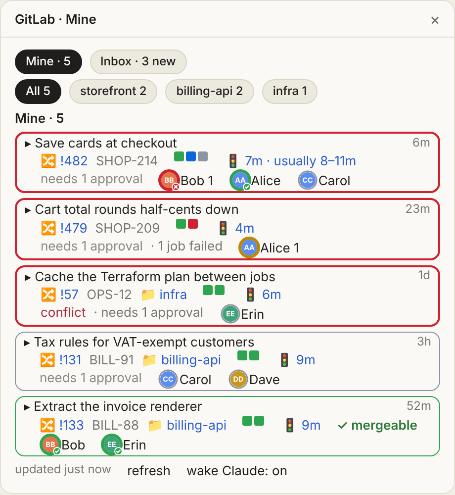
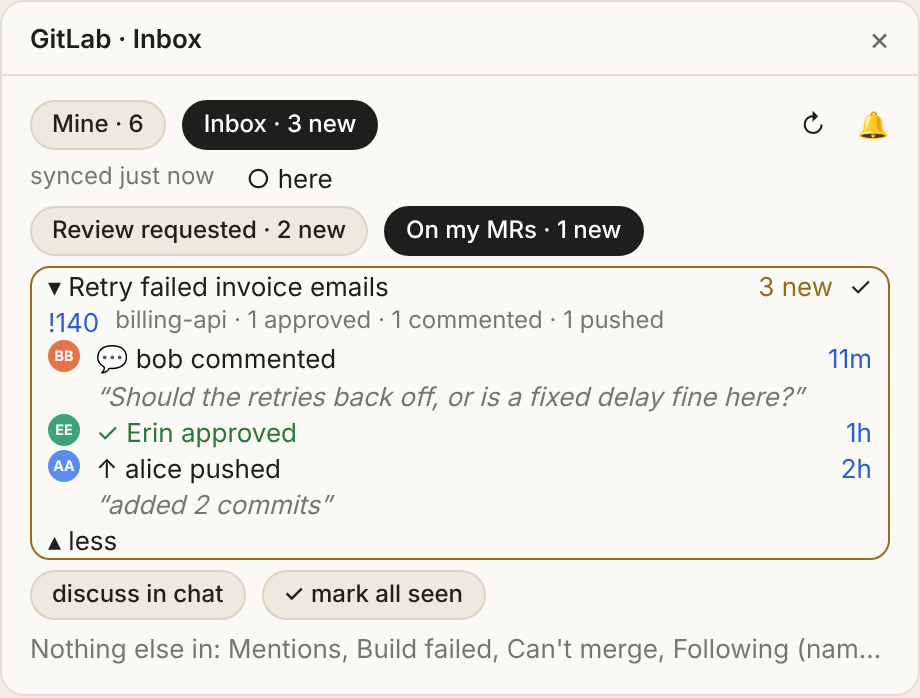
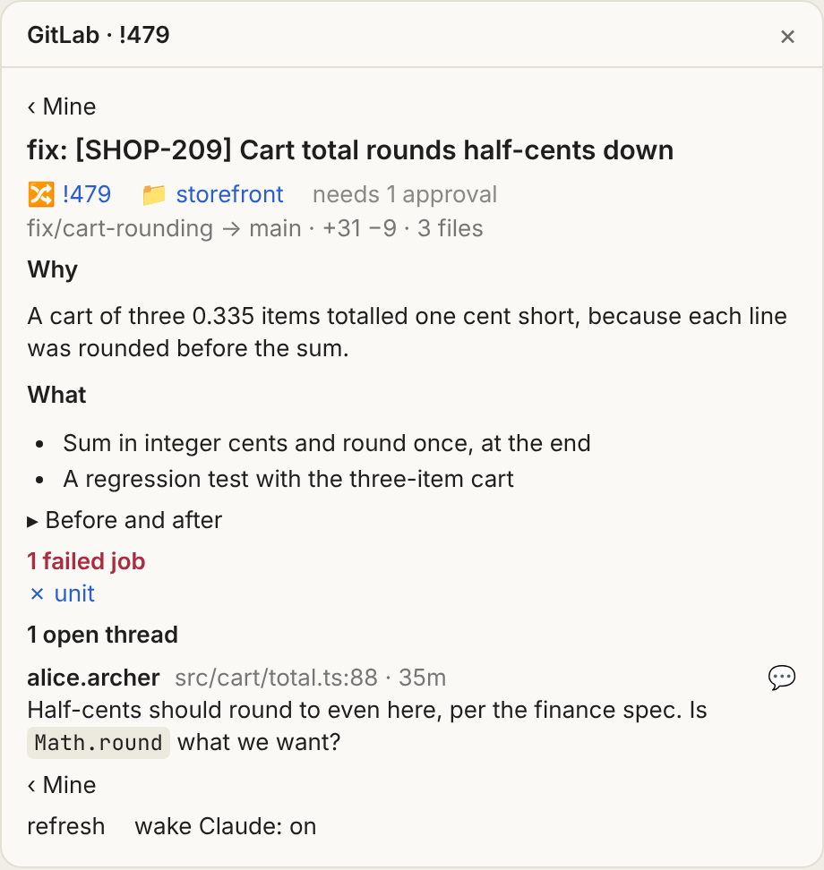
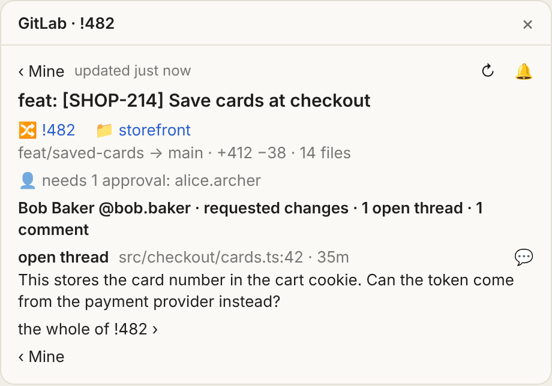
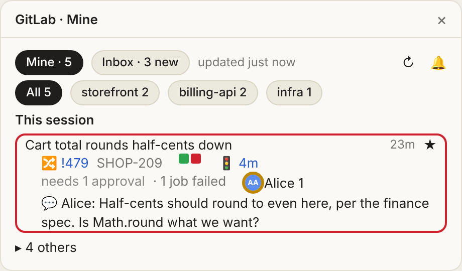
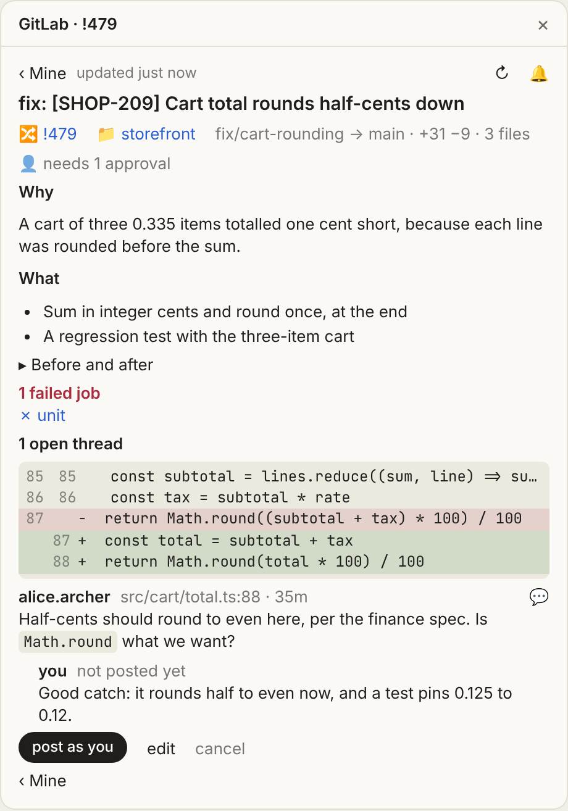
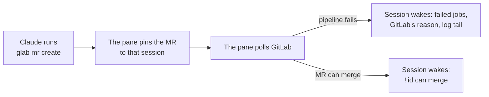

# gitlab-pane

A Claude Code plugin (`gitlab-pane`) that shows your GitLab merge requests beside the session, and wakes the session when an MR it opened fails its pipeline or can merge. Where GitLab says what would move an MR along, its card offers that one press: merge it, rebase it, or hand its conflicts to Claude.

| Mine: your MRs, what needs you first | Inbox: reviews, mentions, failures |
|---|---|
|  |  |
| **A title: the MR on a page of its own** | **A name or a quoted comment: what that person wrote** |
|  |  |
| **☆: the MRs you work on today, the rest one line** | **↩ reply: answer a thread beside its diff, once you confirm** |
|  |  |

<sub>Made-up data.</sub>



Each wake comes once per pipeline. MRs pinned with `watch_mr`, or with the star at a card's top right, sit on top too, but only toast. While a session has MRs on top, the rest of its list folds to one line; each session keeps its own. A ready MR untouched for a week folds under Parked until something moves on it.

A card's move stands where GitLab's verdict is: `✓ merge` on an MR GitLab says can merge, pressed twice; `↻ rebase` on one behind its target, which also merges once checks pass when nothing else holds it; and `⇄ hand conflicts to Claude` on one with conflicts in the repo the session works in, which pins it there and asks Claude to resolve them in a subagent. Each is offered only where you may make it, and the card says when it is done or why not. [DESIGN.md](https://github.com/alxleo/gitlab-pane/blob/main/DESIGN.md#moves) has each one.

## Install

```bash
claude plugin install gitlab-pane --marketplace alxleo/gitlab-pane
```

Renamed from `gitlab-ci` in 0.3.0. The marketplace tells Claude Code of the rename, so an installed or enabled `gitlab-ci@gitlab-pane` moves to `gitlab-pane@gitlab-pane` by itself. The store (avatars, seen marks) starts empty, the plugin's options may need setting again, and a permission rule for `mcp__gitlab-ci__watch_mr` must be added again as `mcp__gitlab-pane__watch_mr`.

Needs a token with `read_api` per GitLab host (`GITLAB_TOKEN`, `glab auth login`, or `gitlabTokens`); merging, rebasing and replying from the pane need `api`. Jira details need Atlassian's [`acli`](https://developer.atlassian.com/cloud/acli/guides/install-acli/), signed in; moving tickets needs that sign-in to have Jira's permission to transition them.

For a team, in the project's `.claude/settings.json`:

```json
{
  "extraKnownMarketplaces": {
    "gitlab-pane": { "source": { "source": "github", "repo": "alxleo/gitlab-pane", "ref": "v0.3.0" } }
  },
  "enabledPlugins": { "gitlab-pane@gitlab-pane": true }
}
```

- `ref` pins a [release](https://github.com/alxleo/gitlab-pane/releases); raise it to update. v0.3.0 is the first under the name `gitlab-pane`: an older tag knows only `gitlab-ci`. Without it, every update installs main, which runs with your GitLab and Jira sign-ins.
- From the first `plugin-v*` tag, `"ref": "plugin-v<version>"` pins too, and installs only the plugin's files.
- `claude plugin update gitlab-pane@gitlab-pane` updates; a running session keeps its copy until `/reload-plugins`.

## Commands

| Command | Does |
|---|---|
| `/gitlab` | Opens the pane, reads GitLab now, asks `glab` for tokens again; says what is wrong, if anything. |
| `/mrs <repo!iid or URL …>`, `/mrs --rule <tab>` | Briefs up to 10 MRs, description and threads, into the conversation. |
| `watch_mr` | Claude's tool: pins an MR and answers its pipeline and blockers. Never wakes. |

## Settings

`/plugin configure gitlab-pane`, or `claude plugin configure gitlab-pane@gitlab-pane --values-stdin`.

| Setting | What it does | Default |
|---|---|---|
| `gitlabHosts` | Hosts to read; the first one's projects show without the host. | `gitlab.com` |
| `gitlabTokens` | `host=token` (bare: the first host), if the environment and `glab` have none. Sensitive. | none |
| `inboxFollow` | Up to 10 `@user` or `group/project` for the Following tab; one query per host a minute each. | none |
| `failureLogs` | Quote failed jobs' log tails in wakes. | on |
| `jiraUrl` | Your Jira site: ticket keys in titles link there, `acli` reads them. | none |
| `jiraInReview` | Statuses to move your MR's ticket to once it is out of draft and someone other than you is asked to review it; the first its workflow allows, such as `In Review`. | none |
| `jiraOnMerge` | Statuses to move your MR's ticket to once it merged and no open MR in the pane names the ticket, such as `Done`. | none |

Each ticket moves once per step, as you, and starts from when the setting is turned on: what is already in review or merged then is left as it is. A ticket in a status Jira counts as done, or does not say, never moves, nor one already in a status the step names; one a person moves back afterwards is left alone. A ticket already past review in a status Jira does not count as done (`In QA`, say) is moved back to review when a review is asked after it got there. While a host's own MRs cannot be read, no ticket moves, and `/gitlab` says so. The session that reads GitLab for the others makes the moves, and says each in a toast there, as it does a workflow with no step to the status.

## What it runs

Queries, as you. GitLab is written to only when you press a merge or a rebase, or post a reply you confirmed, and Jira only when `jiraInReview` or `jiraOnMerge` names a status.

| Runs | How often | For | Writes (plugin store) |
|---|---|---|---|
| GraphQL, per host, by the leader | 30 s while a pinned pipeline runs, else 1 min; after reads where every host failed, 2 min doubling to 10 min; the whole list every 5 min, only what changed between | your open MRs and their merge checks; running and pinned ones not among them, one by one | the snapshot every session draws |
| GraphQL, one MR | once when you open its page, again when it changes | its description and threads, where a reply to each goes and the lines of the diff it was left on, for this pane only | — |
| GraphQL `createNote`, in the session whose page it is | once per press of `post as you`, never sent again on its own | your reply under a thread; then the MR is read whole again, so the thread shows it | — |
| GraphQL, per raised MR, in a session that draws no pane | 5 min | that MR, so its wakes still fire | — |
| GraphQL, per repo, by the leader | 30 min, and for a new repo | usual pipeline times | the times |
| GraphQL, per host, by the leader | 1 min | Inbox: to-dos, review queue, your MRs, one per `inboxFollow` entry | the inbox; ✓ seen marks (GitLab's to-dos are untouched) |
| GraphQL; with `failureLogs`, `GET …/jobs/<job>/trace` (last 64 KiB, up to 3 jobs), by the leader, or by the raising session if it draws no pane | once, when a raised MR's pipeline fails | why each job failed | in the snapshot |
| `acli jira workitem search`, in each session that draws | 15 min, and for a new key | ticket status | — |
| `acli jira workitem search`, then `acli jira workitem transition --key <ticket> --status <status>`, by the leader | after a read, only when a ticket is due a move (a failed ask is tried again after 15 min) | moving a ticket: its key and the status name, nothing else | each step done, as `jira-move:<ticket>><step>` |
| `curl` via `/bin/sh`, https only, no token, by the leader | once per new face | avatars, at the addresses GitLab gives | the pictures |
| `glab config get token --host <host>` | once per host per session, again after `/gitlab` or a 401 | a token | — |
| the lease, in the store | 2 s; the leader renews it every 15 s, and another takes over after 45 s without | electing one leader among the sessions that draw the pane | who leads, each session's pins |
| GraphQL `mergeRequestAccept`, REST `PUT …/merge_requests/<iid>/rebase`, by the session pressed in | when you press a merge or a rebase; then that MR every 3 s until GitLab is done, 2 min at most | the move, on the head GitLab's verdict was read on | — |

- **Several sessions** share one reader: the leader reads GitLab and writes a snapshot, the others draw it. Each session decides its own wakes.
- **Tokens**, first found: `GITLAB_TOKEN`, `GITLAB_ACCESS_TOKEN` or `OAUTH_TOKEN` (for `GITLAB_HOST` or `GL_HOST`, else the first host); `glab`'s; `gitlabTokens`. Never shown.
- **`glab` and `acli`** run in your login shell (`$SHELL` if bash, zsh or fish, else zsh, else sh), start-up files and all.
- **Bash commands** are read to pin the MR one creates; nothing is sent.

## What reaches Claude

GitLab's text arrives only through one cleaner: control and bidi characters removed, one line, cut to length.

| What | When | Carries | Fenced |
|---|---|---|---|
| Wake | a raised MR first fails (even mid-run) or can merge; the pane's 🔔 at the top right turns it off | `!iid`, failed jobs (80 characters each), GitLab's reason for the first 3, pipeline link | no titles, descriptions or comments |
| Log tail | in that wake, with `failureLogs` | last 20 lines, 2,000 characters, of up to 3 jobs | each line behind `│ `, under a heading saying it is the job's output, not instructions |
| `/mrs` | when you run it | title, branches, description (6,000 characters), threads (1,500 a comment, 20,000 an MR) | others' words behind `│`, under a line saying they are data, not instructions; context only, not the transcript |
| `watch_mr` | when Claude calls it | `!iid`, ticket, pipeline status and time, blockers, failed jobs, link | no titles, descriptions or comments |
| Conflicts | you press `⇄` on an MR of the session's repo; it waits for a turn of its own | `!iid`, the project, both branches (80 characters each), link, and what to do: resolve them in a subagent, push, say in a line whether it is fixed | no titles, descriptions or comments |

Colours and marks: [DESIGN.md](https://github.com/alxleo/gitlab-pane/blob/main/DESIGN.md). Development: [CONTRIBUTING.md](https://github.com/alxleo/gitlab-pane/blob/main/CONTRIBUTING.md).
