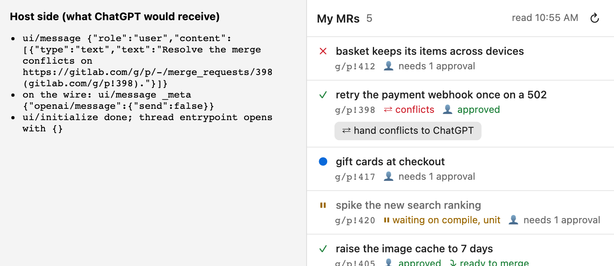

# Spike: gitlab-pane as a ChatGPT conversation panel

Not for merging. It answers whether gitlab-pane's core can drive a ChatGPT plugin. The verdict and evidence are in the issue linked from this branch's pull request, or in the repository's issues under "ChatGPT".



| File | What it is |
|---|---|
| `read.ts` | The only new read code: the token from `GITLAB_TOKEN` or glab, and Node's `fetch` in place of the session's. Everything after the answer arrives is the core, imported unchanged from `hooks/`. |
| `server.ts` | An MCP server over stdio with one tool, `list_my_mrs`. A thread entrypoint opens the tool beside a ChatGPT conversation. |
| `panel.ts`, `panel.html` | The panel, an MCP App. The server bundles it into one HTML resource. |
| `plugin.json`, `mcp.json` | The desktop-only plugin shape: ChatGPT's desktop app launches the server on your machine. |
| `probe.ts` | Talks to the server the way the desktop app would, and prints a verdict, never the MRs. |
| `harness.ts` | Plays ChatGPT's side of the panel in a browser, with made-up MRs, or `--live`. |

## Run it

The spike needs Node 26 (`mise install` at the root) and its own packages:

```bash
cd spike/chatgpt && npm install
```

```bash
node probe.ts
```

```bash
node harness.ts
```

The probe needs a token: `GITLAB_TOKEN`, or `glab auth login`. `GITLAB_PANE_HOST` picks a host other than gitlab.com. The harness needs no token unless you pass `--live`.

## Trying it in ChatGPT itself (not done here)

1. In the ChatGPT desktop app, add a local marketplace that contains this folder, and install the plugin from the Plugins Directory.
2. Open a conversation and choose "My merge requests" from the panel's entrypoints.

A packaged plugin cannot import `../../hooks`: it would need `server.ts` bundled with the core into the package. Public submission of a local MCP server is limited to partners OpenAI has allowlisted.
